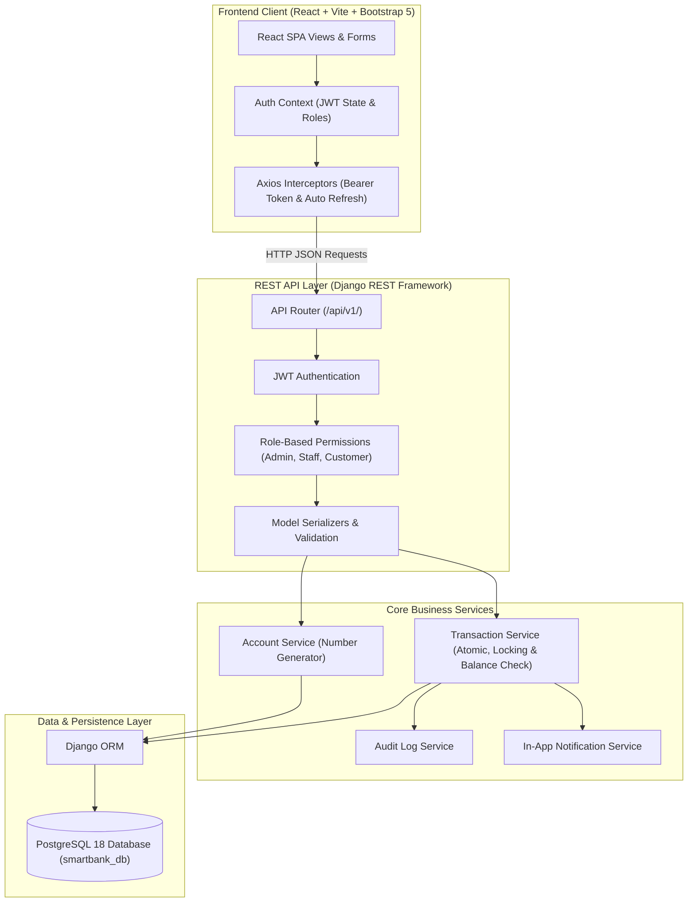
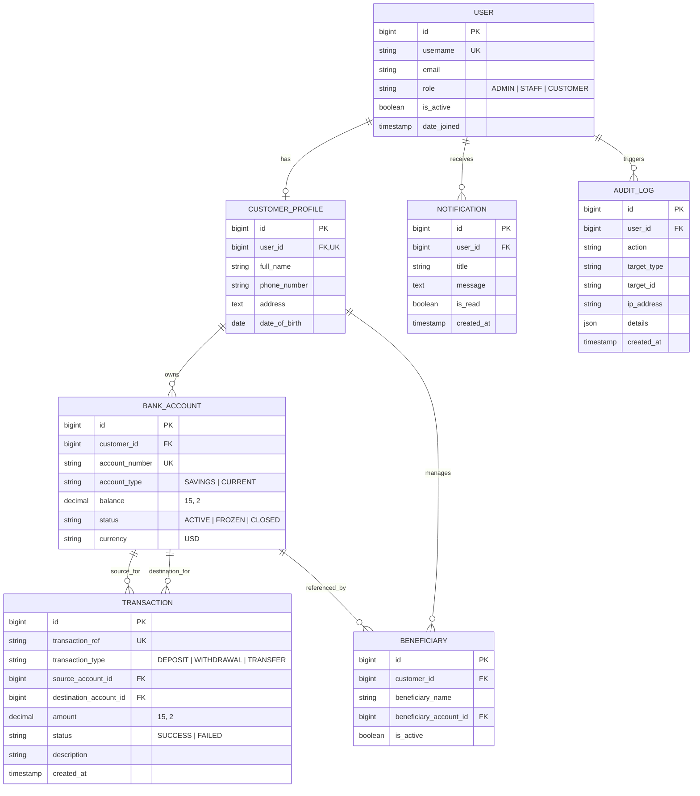

# SmartBank Customer Management System

> **A Full-Stack Educational Banking Simulation & Portfolio Platform**  
> Developed using **Django REST Framework**, **React.js (Vite)**, and **PostgreSQL**.

[](https://www.python.org/)
[](https://www.djangoproject.com/)
[](https://react.dev/)
[](https://www.postgresql.org/)
[](https://getbootstrap.com/)
[](LICENSE)

---

## 1. Project Overview

**SmartBank Customer Management System** is a full-stack, enterprise-style web application built to simulate commercial banking operations. It bridges the gap between theoretical software engineering principles and real-world fintech systems, featuring **Role-Based Access Control (RBAC)**, **ACID-compliant transaction processing with pessimistic locking (`select_for_update()`)**, **JWT authentication with silent refresh**, **in-app customer alerts**, **CSV statement exports**, and **immutable audit logging**.

> [!IMPORTANT]
> **SIMULATION NOTICE:** This project is strictly an educational simulation. No actual bank accounts, payment gateways, or financial networks are connected. All currency balances and transactions are virtual.

---

## 2. Problem Statement & Objectives

Traditional introductory tutorials often demonstrate simplistic CRUD apps with client-side balance manipulation or unsafe floating-point calculations. Real financial software requires:
* **Zero tolerance for double-spending or race conditions** during simultaneous transfers.
* **Strict backend authorization**: Clients must never be able to alter balances by spoofing HTTP requests.
* **Separation of concerns**: Decoupled React Single Page Application (SPA) consuming RESTful endpoints with JWT tokens.
* **Forensic accountability**: Immutable transaction histories and administrative audit trails.

---

## 3. Key Features

### 👤 Customer Operations
* **Online Account Registration:** Self-service registration that immediately initializes a primary Savings account with an opening balance.
* **Multi-Account Management:** Open and manage multiple accounts (`SAVINGS`, `CURRENT`) under one profile.
* **Simulated Deposit & Withdrawal:** Real-time balance updates with strict non-negative validation and overdraft prevention.
* **Internal Account Transfers:** Instant peer-to-peer transfers with pessimistic locking to prevent race conditions.
* **Beneficiary Directory:** Save, validate, and manage internal payees for one-click transfers.
* **Interactive Account Statements:** Filter transactions by date range and download RFC 4180-compliant CSV statements with spreadsheet formula-injection protection.
* **In-App Notification Center:** Real-time alerts for deposits, debits, transfers, and status changes with unread count badges.

### 🛡️ Administrative & Bank Staff Operations
* **Executive Summary Dashboard:** Institutional metrics detailing total customer count, active vs. frozen accounts, and cumulative deposit/withdrawal/transfer volume.
* **Customer Directory:** Full search, filtering, profile editing, and safe customer deactivation.
* **Account Status Control:** Freeze, unfreeze, or terminate bank accounts under compliance review.
* **Global Transaction Ledger:** High-level audit oversight across all transactions executed within the system.
* **Immutable Security Audit Log:** Automatic forensic tracking of authentication, profile updates, account state shifts, and transaction executions.

---

## 4. Technology Stack

| Layer | Technologies |
|---|---|
| **Frontend** | React 19, Vite, React Router DOM (v7), Bootstrap 5, Bootstrap Icons, Axios |
| **Backend API** | Python 3.14+, Django 6.1+, Django REST Framework (DRF), Simple JWT, `psycopg` (v3) |
| **Database** | PostgreSQL 18 (Relational database with strict foreign keys & constraints) |
| **Authentication** | JSON Web Tokens (Access + Refresh tokens with automated silent renewal) |
| **Concurrency & Safety** | Django Database Transactions (`transaction.atomic()`) & Pessimistic Locks (`select_for_update()`) |
| **Environment** | Windows 11 / PowerShell, Virtual Environment (`venv`), `.env` secrets isolation |

---

## 5. System Architecture



For complete architecture details, refer to:
* [Architecture Guide](docs/ARCHITECTURE.md)
* [System Architecture Diagram (Mermaid)](docs/ARCHITECTURE.mmd)
* [Authentication & Authorization Flow](docs/AUTHENTICATION_FLOW.md)
* [Transaction Workflows & Concurrency](docs/TRANSACTION_FLOWS.md)

---

## 6. Database Schema & ERD



Detailed database design documents:
* [Entity-Relationship Diagram (ERD)](docs/ERD.md)
* [ERD Source (Mermaid)](docs/ERD.mmd)
* [Database Schema Specification](docs/DATABASE_SCHEMA.md)
* [Database Relationships & Delete Rationale](docs/DATABASE_RELATIONSHIPS.md)

---

## 7. Folder Structure

```
SmartBank-Customer-Management-System/
│
├── backend/                             # Django REST API Backend
│   ├── manage.py                        # Django administrative CLI
│   ├── requirements.txt                 # Backend Python dependencies
│   ├── .env.example                     # Environment variables template
│   ├── config/                          # Project configuration
│   │   ├── settings.py                  # Database, JWT, CORS, DRF settings
│   │   ├── urls.py                      # Master API routing (/api/v1/)
│   │   ├── wsgi.py / asgi.py            # Deployment entrypoints
│   ├── apps/                            # Modular domain applications
│   │   ├── accounts/                    # Custom User model & JWT authentication
│   │   ├── customers/                   # CustomerProfile CRUD & Directory
│   │   ├── banking/                     # BankAccount model & status management
│   │   ├── transactions/                # Transaction engine & CSV export
│   │   ├── beneficiaries/               # Saved payee management
│   │   ├── notifications/               # In-app notification center
│   │   └── audit/                       # Immutable security audit log
│   ├── tests/                           # Comprehensive test suite (26 passing tests)
│   └── scripts/                         # Demo data seeding automation
│
├── frontend/                            # React.js Vite Frontend
│   ├── package.json                     # Dependencies & build scripts
│   ├── .env.example                     # Frontend API endpoint config
│   ├── index.html                       # HTML5 entrypoint with favicon
│   └── src/
│       ├── api/                         # Axios client with JWT refresh interceptors
│       ├── components/                  # Navbar, Sidebar, Badges, Modals, Spinners
│       ├── context/                     # AuthContext and NotificationContext
│       ├── layouts/                     # Responsive DashboardLayout
│       ├── pages/                       # Login, Register, Dashboards, Transfers
│       ├── routes/                      # Route guards & RBAC routing
│       └── styles/                      # Custom financial styling
│
├── docs/                                # Technical & Architectural Documentation
│   ├── ARCHITECTURE.md                  # High-level system design
│   ├── ARCHITECTURE.mmd                 # Mermaid architecture diagram
│   ├── ERD.md                           # Entity Relationship documentation
│   ├── ERD.mmd                          # Mermaid ERD source
│   ├── DATABASE_SCHEMA.md               # PostgreSQL table specifications
│   ├── DATABASE_RELATIONSHIPS.md        # Relational constraints & cardinality
│   ├── API_DOCUMENTATION.md             # Complete REST endpoint specifications
│   ├── AUTHENTICATION_FLOW.md           # Sequence diagram for JWT lifecycle
│   ├── TRANSACTION_FLOWS.md             # Workflows for deposit, withdraw, transfer
│   └── TESTING_GUIDE.md                 # Test execution instructions
│
├── .gitignore                           # Git exclusion rules
└── README.md                            # Primary documentation
```

---

## 8. Step-by-Step Windows Installation & Execution Guide

Follow these exact PowerShell commands to run the project locally.

### Prerequisites
1. **Python 3.12+ (or 3.14)**: Verify with `python --version`
2. **Node.js v18+ (or v24)**: Verify with `node --version` and `npm --version`
3. **PostgreSQL 15+ (or 18)**: Active on port `5432`

---

### Step 1: Database Setup (PostgreSQL)
Ensure the PostgreSQL server is running. Create the database:
```powershell
& "C:\Program Files\PostgreSQL\18\bin\psql.exe" -U postgres -c "CREATE DATABASE smartbank_db;"
```

---

### Step 2: Backend Setup & Virtual Environment
From the project root:
```powershell
# 1. Create a Python virtual environment
python -m venv venv

# 2. Activate the virtual environment
.\venv\Scripts\Activate.ps1

# 3. Upgrade pip and install dependencies
pip install -r backend/requirements.txt

# 4. Create your local .env file
Copy-Item backend/.env.example backend/.env

# 5. Run database migrations
python backend/manage.py migrate

# 6. Seed demonstration users and initial bank accounts
python backend/manage.py seed_demo_data

# 7. Start the Django development server
python backend/manage.py runserver 8000
```
> The API will now be listening at `http://127.0.0.1:8000/api/v1/`.

---

### Step 3: Frontend Setup & Server
Open a second PowerShell terminal in the project root:
```powershell
# 1. Navigate to frontend directory
cd frontend

# 2. Install Node dependencies
npm install

# 3. Start the Vite React development server
npm run dev
```
> The frontend will launch at `http://localhost:5173`. Open this URL in your web browser.

---

## 9. Demonstration Credentials

The database comes pre-seeded with fictional accounts for technical demonstrations:

| Role | Username | Password | Notes |
|---|---|---|---|
| **Administrator** | `admin` | `AdminPassword123!` | System-wide oversight & full audit logs |
| **Bank Staff** | `staff1` | `StaffPassword123!` | Customer management & account freezing |
| **Customer** | `alice` | `AlicePassword123!` | Active Savings & Current accounts with balance |
| **Customer** | `bob` | `BobPassword123!` | Active Savings account; linked beneficiary |
| **Customer** | `charlie` | `CharliePassword123!` | Holds a `FROZEN` account for compliance testing |

> *Tip: The Login page includes one-click demo login buttons to instantly switch between Customer, Staff, and Admin roles.*

---

## 10. Automated Testing Suite

The backend includes a 26-test automated verification suite testing:
* Registration & JWT Token generation.
* Role-based access control (RBAC).
* Balance constraints & negative amount rejection.
* Overdraft protection & atomic transfer rollbacks.
* Concurrency protection (`select_for_update()`).
* Beneficiary verification & ownership checks.
* In-app notification isolation.
* CSV statement export security.

Run the test suite with:
```powershell
.\venv\Scripts\python.exe backend/manage.py test tests --verbosity=2
```

**Verified Test Results:**
```
Ran 26 tests in 38.490s
OK (26 passed, 0 failures, 0 errors)
```

---

## 11. Known Limitations & Future Enhancements

* **Simulated Environment:** As a learning and portfolio demonstration, the system does not integrate with real Automated Clearing House (ACH) or SWIFT payment networks.
* **Email / SMS Dispatch:** Alerts are dispatched in-app; integration with SendGrid or Twilio can be added for external email/SMS notifications.
* **Scheduled Interest Accrual:** A recurring background job (e.g. Celery / cron) can be introduced to simulate monthly savings interest payments.

---

