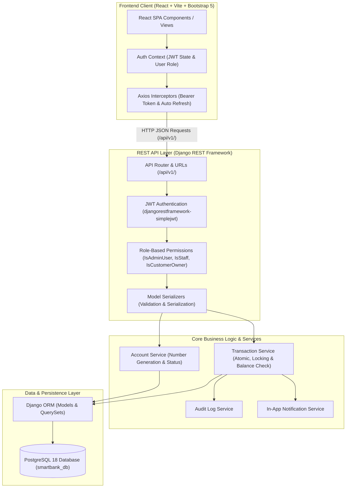

# SmartBank System Architecture Documentation

## 1. High-Level Architecture Overview

The **SmartBank Customer Management System** follows a clean, decoupled monolithic architecture separating a React Single Page Application (SPA) frontend from a Django REST Framework (DRF) backend API, backed by a persistent PostgreSQL relational database.

---

## 2. Frontend Architecture (React.js + Vite)

The frontend is an intuitive Single Page Application (SPA) designed to resemble a professional commercial banking portal.

* **Build Tool:** Vite for lightning-fast Hot Module Replacement (HMR) and optimized ES builds.
* **UI Framework:** Bootstrap 5 with responsive grid, accessible modal dialogs, status badges, and Bootstrap Icons.
* **Routing:** `react-router-dom` (v6/v7) with nested layouts and route guards:
  * `ProtectedRoute`: Ensures only authenticated users can access internal routes.
  * `RoleBasedRoute`: Enforces role-specific views (`ADMIN`, `STAFF`, `CUSTOMER`).
* **State Management:**
  * `AuthContext`: Centralizes authentication tokens, decoded user payload, login/logout functions, and token renewal.
  * `NotificationContext`: Polls and caches unread notifications, providing reactive unread badge counts across navigation items.
* **HTTP Client (`api/axios.js`):** Centralized Axios instance with request and response interceptors:
  * Automatically injects `Authorization: Bearer <access_token>`.
  * Catches `401 Unauthorized` responses and silently requests a new access token via `/api/v1/auth/token/refresh/`.

---

## 3. Backend Architecture (Django REST Framework)

The backend follows modular Django architecture structured under the `apps/` directory:

1. **`apps/accounts`:** Custom `User` model inheriting from `AbstractUser`. Distinguishes roles (`ADMIN`, `STAFF`, `CUSTOMER`).
2. **`apps/customers`:** `CustomerProfile` managing customer personal details, address, contact, and active state.
3. **`apps/banking`:** `BankAccount` entity supporting Account Types (`SAVINGS`, `CURRENT`) and Account Status (`ACTIVE`, `FROZEN`, `CLOSED`). Provides secure unique account number generation.
4. **`apps/transactions`:** Financial transaction engine supporting `DEPOSIT`, `WITHDRAWAL`, and `TRANSFER`. Uses Django database transactions (`transaction.atomic()`) and pessimistic locking (`select_for_update()`) to ensure absolute ACID compliance and prevent double-spending.
5. **`apps/beneficiaries`:** Manages trusted transfer beneficiaries mapped to active internal accounts.
6. **`apps/notifications`:** In-app notification dispatch and tracking (unread counter, mark-as-read).
7. **`apps/audit`:** Immutable audit trails recording critical security and administrative actions.

---

## 4. Database Architecture (PostgreSQL)

* Relational storage using **PostgreSQL 18**.
* Database name: `smartbank_db`.
* Managed strictly through Django ORM migrations.
* Strict foreign key constraints with `on_delete=models.PROTECT` or `CASCADE` where appropriate to safeguard historical financial integrity.
* Decimal precision: Balances and transaction amounts use `DecimalField(max_digits=15, decimal_places=2)` to prevent floating-point arithmetic errors.

---

## 5. Security & Isolation Model

1. **Password Hashing:** PBKDF2 with SHA-256 via Django's authentication system.
2. **Token Security:** Short-lived access tokens (15–60 minutes) paired with refresh tokens (1–7 days).
3. **Object-Level Permissions:** Customers can only query their own accounts, transactions, beneficiaries, and notifications. Staff/Admins can view customer and account directories based on permission tiers.
4. **Immutability:** Transaction logs and audit logs cannot be edited or deleted by clients.
