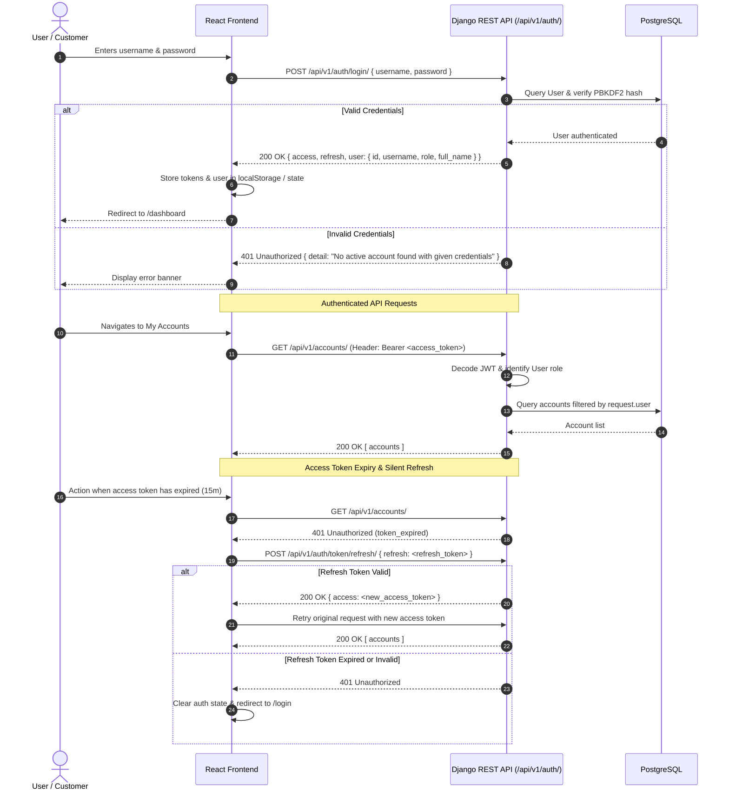

# Authentication & Authorization Flow

This document details the JSON Web Token (JWT) lifecycle and role-based access control (RBAC) mechanism.

---

## 1. Sequence Diagram: JWT Authentication Flow

---

## 2. Role-Based Permissions Matrix

| Endpoint | ADMIN | STAFF | CUSTOMER |
|---|---|---|---|
| `POST /api/v1/auth/register/` | Public / Open | Public / Open | Public / Open |
| `POST /api/v1/auth/login/` | Public / Open | Public / Open | Public / Open |
| `GET /api/v1/profile/` | Self | Self | Self |
| `GET /api/v1/customers/` | All customers | All customers | Forbidden (403) |
| `POST /api/v1/customers/` | Allowed | Allowed | Forbidden (403) |
| `GET /api/v1/accounts/` | All accounts | All accounts | Own accounts only |
| `PATCH /api/v1/accounts/{id}/status/` | Allowed | Allowed | Forbidden (403) |
| `POST /api/v1/transactions/deposit/` | Allowed | Allowed | Allowed (Own active accounts) |
| `POST /api/v1/transactions/withdraw/` | Allowed | Allowed | Allowed (Own active accounts) |
| `POST /api/v1/transactions/transfer/` | Allowed | Allowed | Allowed (Own active accounts) |
| `GET /api/v1/audit/` | Allowed | Allowed (Read) | Forbidden (403) |
| `GET /api/v1/dashboard/` | System overview | Staff metrics | Customer metrics & balance |
