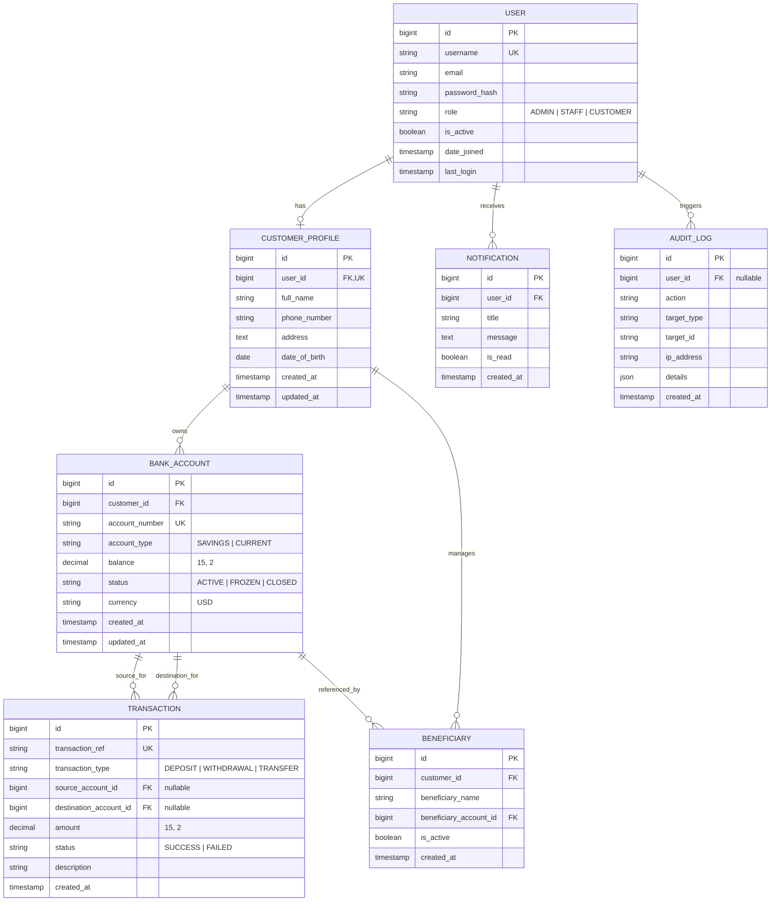

# SmartBank Entity-Relationship Diagram (ERD)

This document visualizes and outlines all entities, attributes, primary keys, foreign keys, and cardinalities for the SmartBank Customer Management System.

## Mermaid ERD

---

## Entity Summary Table

| Entity | Primary Key | Key Foreign Keys | Purpose |
|---|---|---|---|
| **User** | `id` | None | Base credentials, login, and authorization role (`ADMIN`, `STAFF`, `CUSTOMER`). |
| **CustomerProfile** | `id` | `user_id` (OneToOne) | Personal info for customers (Name, Phone, Address, DOB). |
| **BankAccount** | `id` | `customer_id` (ForeignKey) | Bank accounts holding simulated currency balances. |
| **Transaction** | `id` | `source_account_id` (FK, Nullable), `destination_account_id` (FK, Nullable) | Immutable financial ledger records for Deposits, Withdrawals, Transfers. |
| **Beneficiary** | `id` | `customer_id` (FK), `beneficiary_account_id` (FK) | Saved payee accounts for simplified internal money transfers. |
| **Notification** | `id` | `user_id` (FK) | Real-time in-app customer alerts for transaction & account updates. |
| **AuditLog** | `id` | `user_id` (FK, Nullable) | Security and compliance tracking for administrative actions. |
