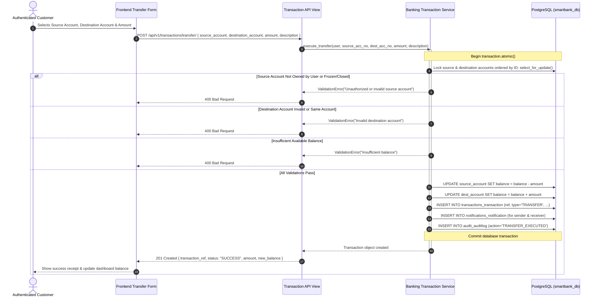

# Financial Transaction Workflows

This document details the core transaction workflows: Deposit, Withdrawal, and Internal Transfer. It highlights transactional integrity, database row-level locking (`select_for_update()`), and atomic rollbacks.

---

## 1. Sequence Diagram: Internal Account-to-Account Transfer



---

## 2. Deposit Workflow

1. Customer or Bank Staff selects an active destination account.
2. The user enters an amount ($> 0.00$).
3. Inside `transaction.atomic()`:
   * The destination account is locked with `select_for_update()`.
   * Verifies that the destination account status is `ACTIVE`.
   * Increments `balance = balance + amount`.
   * Creates a `Transaction` record with `transaction_type='DEPOSIT'`, `source_account=None`, and `destination_account=dest_account`.
   * Dispatches an in-app notification to the account owner.
   * Records an audit log entry.
4. Transaction commits; returns reference and updated balance.

---

## 3. Withdrawal Workflow

1. Customer selects their active account and specifies an amount.
2. Inside `transaction.atomic()`:
   * The source account is locked with `select_for_update()`.
   * Verifies ownership by the authenticated user (or Staff override).
   * Verifies that the account is `ACTIVE`.
   * Verifies `balance >= amount`. If insufficient, rolls back and raises `ValidationError("Insufficient balance.")`.
   * Decrements `balance = balance - amount`.
   * Creates a `Transaction` record with `transaction_type='WITHDRAWAL'`, `source_account=source_account`, and `destination_account=None`.
   * Dispatches an in-app notification.
   * Records an audit log entry.
5. Transaction commits; returns reference and remaining balance.

---

## 4. Concurrency Protection & Row Ordering

When transferring between Account A and Account B, locking them in arbitrary order can cause deadlocks if another concurrent process is transferring from Account B to Account A.
SmartBank avoids deadlocks by sorting the account IDs before acquiring locks:
```python
account_ids = sorted([source_id, dest_id])
accounts = BankAccount.objects.select_for_update().filter(id__in=account_ids)
```
This guarantees consistent acquisition order across all threads.
